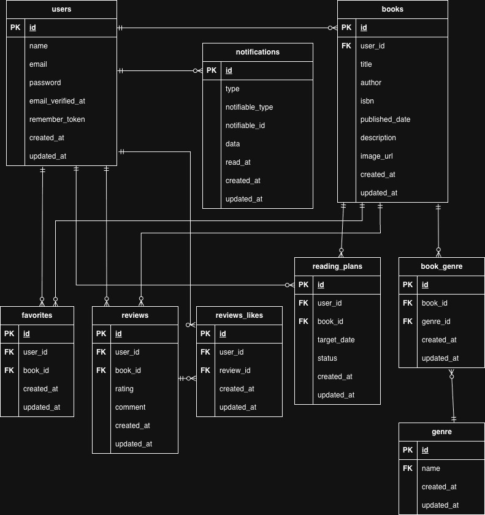

# BookShelf 書籍レビューアプリ

## Laravel 環境構築

1. リポジトリのクローン
git clone <https://github.com/kinoppe/trial_project_3.git>
cd bookshelf-app
2. 環境変数を適宜変更
cp .env.example .env ,
```
DB_CONNECTION=mysql
DB_HOST=mysql
DB_PORT=3306
DB_DATABASE=laravel
DB_USERNAME=sail
DB_PASSWORD=password
```
3. docker run --rm \-u "$(id -u):$(id -g)" \-v "$(pwd):/var/www/html" \-w /var/www/html \
laravelsail/php82-composer:latest \
composer install
4. ./vendor/bin/sail up -d
5. ./vendor/bin/sail artisan key:generate
6. ./vendor/bin/sail artisan migrate --seed
データベースを初期化する場合は以下を実行
./vendor/bin/sail artisan migrate:fresh --seed
7. ./vendor/bin/sail npm install
8. ./vendor/bin/sail npm run dev

## API仕様

* 書籍一覧取得
GET /api/v1/books
認証不要
* 書籍詳細取得
GET /api/v1/books/{book}
認証不要
* 書籍新規登録
POST /api/v1/books
Sanctum認証必須
* 書籍情報更新
PUT /api/v1/books/{book}
Sanctum認証必須、認可必須
* 書籍削除
DELETE /api/v1/books/{book}
Sanctum認証必須、認可必須

API認証
* Authorization: Bearer APIトークンを設定
* Accept: application/json
* Content-Type: application/json

## テストケース

全てのテスト実行

./vendor/bin/sail artisan test

Unitテスト実行

./vendor/bin/sail artisan test tests/Unit

Featureテストのみ実行

./vendor/bin/sail artisan test tests/Feature

特定ファイルを実行する場合はテストファイルパスを指定

./vendor/bin/sail artisan test tests/Feature/Book/BookIndexTest.php

テストカバレッジ

./vendor/bin/sail artisan test --coverage

## 使用技術

* PHP： 8.5
* Laravel： 10.x
* DB：MySQL 8.4
* フロントエンド：Vite, Tailwind CSS ^3.4.0, @tailwindcss/forms

## ER図



## URL

開発環境
* 会員登録画面：http://localhost/register
* ログイン画面：http://localhost/login
* 書籍一覧画面：http://localhost/books
* 書籍詳細画面：http://localhost/books{book}
* 書籍登録：http://localhost/books/create
* 書籍ランキング：http://localhost/ranking
* お気に入り一覧：http://localhost/favorite
* ジャンル管理：http://localhost/genres
* マイレポート：http://localhost/report
* 読書計画：http://localhost/reading-plans
* 通知一覧：http://localhost/notifications
* phpMyAdmin：http://localhost:8080/

## ログイン情報

./vendor/bin/sail artisan migrate --seed実行時のダミーデータ

* 山田太郎： メールアドレス / パスワード
yamada@example.com / password
* 鈴木花子： メールアドレス / パスワード
suzuki@example.com / password
* 田中一郎： メールアドレス / パスワード
tanaka@example.com / password
* 佐藤美咲： メールアドレス / パスワード
sato@example.com / password
* 高橋健太： メールアドレス / パスワード
takahashi@example.com / password

## 作成者
木下　悠哉